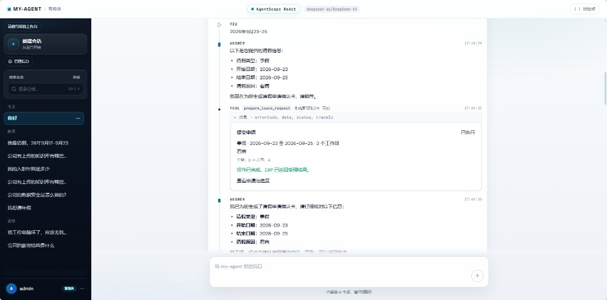
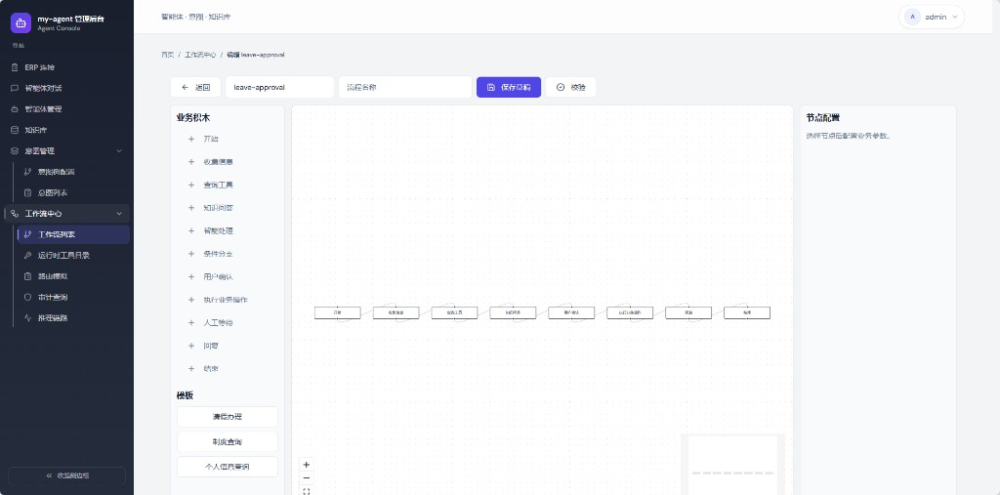
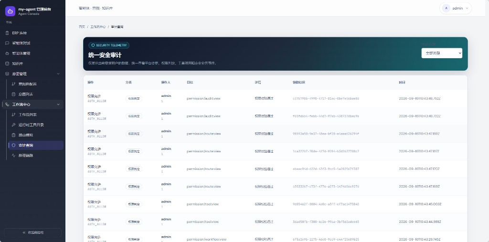
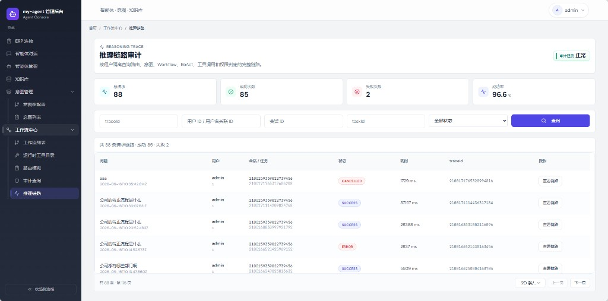
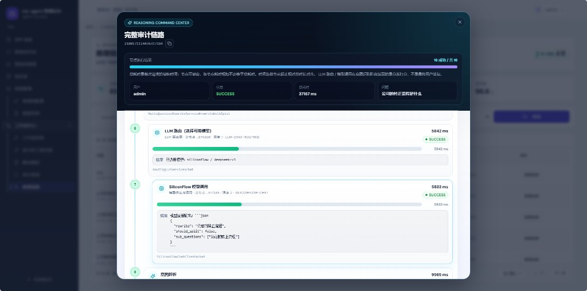

# my-agent

企业知识问答 + 受控业务办理的 Java 智能体平台。  
用户可以查制度、问年假、发起请假，系统走固定工作流而不是让模型直接改业务数据；写操作必须弹出确认卡，权限、事务和审计都在 Java 服务端强制执行。

本项目在学习 [Ragent](https://github.com/nageoffer/ragent) 的基础上继续演进：保留文档入库、意图识别、检索与 ReAct 骨架，补上企业工作流、可视化编排、平台 RBAC、推理链路审计，以及与业务系统隔离的 ERP 适配。

> 参考项目：[nageoffer/ragent](https://github.com/nageoffer/ragent)

## 效果图

智能体对话：收集请假信息、调用工具、生成待确认申请。



可视化工作流设计器：用业务积木编排请假审批，而不是手写一整份 BPMN。



统一安全审计：权限判定、操作对象与链路 ID 可查询。



推理链路列表：按会话 / 任务聚合成功、失败与耗时。



完整审计链路：展开模型路由、工具调用和每个节点的耗时。



## 相对 Ragent 做了什么

Ragent 把「文档解析 → 多路检索 → 意图识别 → MCP / 深度思考」这条 Agentic RAG 链路讲清楚了。my-agent 在这条链路上把智能体从「会问答」推进到「能在权限内把事情办完」。

| 点 | Ragent | my-agent |
| --- | --- | --- |
| 核心场景 | 知识问答、检索增强、MCP 示例工具 | 知识问答 + 请假审批等真实业务办理 |
| 执行方式 | RAG 管线 + ReAct 骨架 | 意图路由到 **固定工作流 / ReAct / 澄清 / 拒绝** |
| 写操作 | 工具调用为主 | **确认卡 + 幂等 + 服务端身份**，模型不能指定操作人 |
| 流程 | 无可视化业务编排 | **业务积木设计器**、版本、审核、模拟门禁、发布冻结 |
| 权限 | 登录与基础角色 | **平台 RBAC** 与企业审批角色分离，管理员不能代替主管/HR 审批 |
| 审计 | Trace / 管理端 | **统一安全审计 + 推理链路节点级耗时** |
| 业务系统 | 示例 MCP | 可选 **独立 internal-erp**，库和令牌与智能体隔离 |
| 工具治理 | MCP 发现与提参 | 连接器只存 `secretRef`、工具契约审核后才进入运行时目录 |

仍然沿用 Ragent 里已经验证过的工程能力：文档摄取 Pipeline、问题重写、意图树、混合检索框架、模型档位与路由、Sa-Token、SSE、AgentScope ReAct。

## 功能特点

- **制度问答带出处**：检索结果按知识库授权过滤，回答带来源、片段和生效版本。
- **请假闭环**：查档案 / 余额 → 补参 → 确认卡 → 主管审批 → 人事审批 → 进度查询；年假冻结与释放在事务里完成。
- **可视化工作流**：画布节点编译成受控流程，发布后运行时只认冻结版本。
- **动态运行时**：实例持久化、等待用户插问、确认后才调 ERP/本地服务，进程重启可恢复。
- **MCP 治理**：发现 → 审核 → 发布 → 绑定意图；数据库不保存真实 Token。
- **双库隔离**：`myagent` 只放智能体状态；`internal_erp` 放组织与请假事实。

## 模块

| 模块 | 职责 |
| --- | --- |
| `framework` | 统一响应、异常、UserContext、MQ、Snowflake、Trace、SSE |
| `system` | Sa-Token JWT、用户、平台 RBAC |
| `infra-ai` | Chat / Embedding / 模型档位与路由 |
| `rag` | 知识库、摄取、检索、MCP 目录 |
| `agent` | AgentScope ReAct、工具网关、会话与确认卡事件 |
| `enterprise` | 企业身份、本地请假引擎、ERP HTTP 适配 |
| `workflow` | 流程定义、编译发布、Flowable 运行时 |
| `bootstrap` | 启动入口，不含业务代码 |
| `frontend` | 智能体工作台 + 管理后台 |
| `internal-erp` | 可选的独立 ERP 服务 |

## 技术栈

- Java 17、Spring Boot 4.1、MyBatis-Plus、Sa-Token JWT、AgentScope 2.0.2、Flowable 8
- PostgreSQL + pgvector、Redis、RocketMQ、MinIO/S3
- 前端 React + Vite
- 模型：OpenAI 兼容接口（默认硅基流动 DeepSeek-V3 / bge-m3，可切阿里云百炼）

## 仓库里没有密钥

真实 API Key、JWT 密钥、RSA 私钥、MCP Token、数据库密码 **都不会进 Git**。

1. 复制 `.env.example` 为 `.env`，把 `YOUR_*` 换成自己的值。
2. 前端复制 `frontend/.env.example` 为 `frontend/.env`。
3. 若启用独立 ERP，再复制 `internal-erp/.env.example`。
4. 本机 Maven 路径写在 `.mvn/maven.config`（已忽略），示例见 `.mvn/maven.config.example`。

生成 ERP MCP 密钥对：

```bash
openssl genrsa -out erp-mcp-private.pem 2048
openssl rsa -in erp-mcp-private.pem -pubout -out erp-mcp-public.pem
```

把 PEM 中间的 Base64 填进环境变量：私钥只给 my-agent，公钥给 internal-erp。

## 部署

### 1. 准备环境

- JDK 17、Maven 3.6+、Node.js 18+、Docker
- 至少一种模型平台 API Key

### 2. 启动中间件

在仓库根目录：

```bash
docker compose -f deploy/docker-compose.yml up -d
```

会拉起 PostgreSQL（pgvector）、Redis、MinIO、RocketMQ。  
compose **仅供本地演示**，默认口令写在该文件顶部注释里；请把同样的值填进 `.env`。已有中间件可跳过这一步，只要端口和账号对得上。

| 服务 | 地址 | 用途 |
| --- | --- | --- |
| PostgreSQL | `127.0.0.1:5432` | `myagent` 业务库 + `internal_erp` |
| Redis | `127.0.0.1:6379` | 登录、锁、限流 |
| MinIO | `9000` / 控制台 `9001` | 知识库原文件 |
| RocketMQ NameServer | `9876` | 文档分块消息 |

MinIO 桶：`myagent-sources`、`myagent-assets`（compose 会尝试自动创建）。

### 3. 初始化数据库

**智能体库 `myagent`：**

```powershell
cd resources/database
.\init.ps1
```

Linux / macOS：

```bash
cd resources/database
chmod +x init.sh
./init.sh
```

脚本会建库、执行基础 schema，再按 v0.4.0 → v0.10.0 应用增量（含字段注释）。可重复执行。

**ERP 库 `internal_erp`：** compose 首次建卷时会 `CREATE DATABASE`；表结构由 Flyway 在 `internal-erp` 启动时执行 `V1`/`V2`/`V3`。

每张表做什么、字段含义见 [resources/database/README.md](resources/database/README.md)。

### 4. 填写配置

```bash
cp .env.example .env
cp frontend/.env.example frontend/.env
```

最少必填：

- `SILICONFLOW_API_KEY` 或 `BAILIAN_API_KEY`
- `SA_TOKEN_JWT_SECRET_KEY`
- 数据库 / Redis / MinIO 密码（与中间件一致）

本地只跑请假演示时保持：

```env
ENTERPRISE_ADAPTER=LOCAL
```

要对接独立 ERP 时改为 `HTTP_ERP`，并启动 `internal-erp`。

### 5. 启动智能体后端

```bash
mvn -pl bootstrap -am package -DskipTests
```

Windows 推荐：

```powershell
powershell -ExecutionPolicy Bypass -File .\scripts\start-backend.ps1
```

脚本会读取 `.env` 再启动，profile 默认 `enterprise`。

也可以：

```bash
# 先自行 export / 设置与 .env 相同的环境变量
java -jar bootstrap/target/bootstrap-0.0.1-SNAPSHOT.jar --spring.profiles.active=enterprise
```

- 端口：`18080`
- Swagger：http://localhost:18080/swagger-ui.html

### 6. 启动前端

```bash
cd frontend
npm install
npm run dev
```

打开 http://127.0.0.1:5173 。

### 7. 可选：独立 ERP

```bash
cd internal-erp
cp .env.example .env
mvn -DskipTests package
java -jar target/internal-erp-0.1.0-SNAPSHOT.jar
```

端口 `18081`。说明见 [internal-erp/README.md](internal-erp/README.md)。

## 演示账号

应用以 `enterprise` profile **首次启动**时写入（已存在同名用户不会重置密码）：

| 账号 | 密码 | 用途 |
| --- | --- | --- |
| `admin` | `admin` | 后台、知识库、工作流、审计；**不能**代替主管或 HR 审批 |
| `demo` | `user123` | 普通用户 |
| `employee` | `Enterprise123!` | 查询年假、发起/撤回请假 |
| `manager` | `Enterprise123!` | 主管一级审批 |
| `hr` | `Enterprise123!` | 人事二级审批 |

这些是本地演示口令，不是生产密钥。上线请立即修改。

## 建议验证路径

1. 用 admin 登录管理后台，确认知识库、工作流 `leave-approval`、审计页可打开。
2. 导入制度：`node resources/enterprise/seed-knowledge.cjs`（需后端已启动）。
3. 用 employee 对话：「我今年还剩几天年假？」「帮我请 9 月 23 日到 25 日的病假」。
4. 在卡片上确认提交，再分别用 manager、hr 审批。
5. 打开「推理链路」查看该次请求的模型路由与工具调用。

更细的企业演示说明：[resources/enterprise/README.md](resources/enterprise/README.md)。

## 安全注意

- 不要把 `.env`、私钥、`MCP_DISCOVERY_TOKEN_*` 提交到 Git。
- MCP 连接器只保存 `secret_ref`，Token 从环境变量或 Vault 解析。
- 写操作走确认卡；身份取自登录上下文，不接受模型传入的操作人。
- 生产环境必须替换 JWT 密钥、ERP 服务令牌和全部中间件口令。

## 致谢

- [Ragent](https://github.com/nageoffer/ragent) 提供了 Agentic RAG 的工程基线与模块划分思路。
- [AgentScope](https://java.agentscope.io/) 提供 ReAct 运行时。
